# Awaaz — civic complaints in your own voice

Built for the **Meta Global AI Developer Hackathon** (Oct 27 – Nov 4, 2026), Indie track.

> **All code in this repository was written during the hackathon week.** Nothing was carried over from earlier projects; the git history starts on Oct 27.

In small-town India a broken road, a dry tap or a live wire hanging over a roof usually goes unreported: the
forms are in English, the offices are far, and nobody knows which department owns the problem. **Awaaz**
("voice") lets a citizen in Supaul, Bihar just *say* the problem in Hindi, Hinglish or English, add a photo, and
get back a tracking number. An agent turns the report into a formal complaint for the right department,
checks the photo, merges it with reports of the same problem, and keeps the citizen updated in plain Hindi.

| Citizen | Officer |
|---|---|
| Speaks or types the problem, adds a photo | Sees a queue sorted by danger, then by how many people reported it |
| Gets the department, urgency and a tracking number in seconds | Sees why: the agent's tool trace, the photo with SAM's mask, a ready Hindi letter |
| Phone and Aadhaar numbers are hidden before anyone sees the report | Hotspots show where the same problems keep coming back |
| Reads updates in simple Hindi, written from the officer's own note | Writes a two-word note; the citizen gets a proper Hindi update |

## How it works

```mermaid
flowchart LR
    subgraph Phone["Citizen's phone (browser)"]
        mic["Mic → 16 kHz WAV<br/>(encoded in the browser)"]
        cam["Photo → 1600 px JPEG<br/>(EXIF/GPS dropped on the phone)"]
    end
    mic --> asr["Muse Voice Transcribe<br/>Hindi / Hinglish"]
    asr --> text["Report text"]
    text --> pii["PII masking<br/>mobile · Aadhaar · email · PAN"]
    cam --> agent
    pii --> agent

    subgraph agent["Complaint agent — Muse Spark 1.3 tool loop"]
        direction TB
        s["search_similar_complaints"] --> p["check_photo → SAM 3.1"]
        p --> d["submit_decision"]
        d --> v{"verify_decision<br/>(in code)"}
        v -- "errors go back as the tool result" --> s
    end

    v -- accepted --> db[("SQLite<br/>complaints · updates · trace")]
    db --> dash["Officer dashboard<br/>queue · hotspots · trace · SAM overlay"]
    dash -- "officer note" --> open["Muse Spark Open (Baseten)<br/>plain-Hindi update + checks"]
    open --> db
    db --> track["Citizen tracking page"]
```



### Meta models

| Model | Where | What it does in Awaaz |
|---|---|---|
| **Muse Spark 1.3** | Meta Model API | The complaint agent: tool calls, routing, urgency, duplicate decisions, the formal Hindi letter |
| **Muse Voice Transcribe** | Meta Model API | Hindi / Hinglish voice reports to text (browser sends 16 kHz mono WAV) |
| **SAM 3.1** | Meta Model API | Finds the reported problem in the citizen's photo; its masks are drawn over the photo for officers |
| **Muse Spark Open** (open weights) | Baseten | Turns an officer's terse note ("JE ne site dekh li") into a plain-Hindi update for the citizen |

Citizen data only goes to the standard models, never the `-contributor` variants that train on prompts.

## The agent, and why its answers can be trusted

`backend/app/agent.py` runs Muse Spark 1.3 in a Chat Completions tool loop with three tools:

1. `search_similar_complaints(area, category, keywords)` — open complaints at the same place in the last 30 days
2. `check_photo(concept)` — SAM 3.1 counts the problem ("pothole", "garbage pile") in the photo
3. `submit_decision(...)` — valid or not, category, urgency and reason, duplicate link, Hindi letter, reply

The final decision is **checked in code, not trusted** (`verify_decision`):

- a duplicate must be an id the search actually returned, and the search must have run;
- "the photo shows it" must agree with SAM's counts, and a photo must have been checked at all;
- high or critical urgency needs a stated reason; the letter must really be Devanagari Hindi;
- the department comes from a fixed catalog keyed by category, so the model cannot invent one.

A failed check goes back to the model as the tool result and it corrects itself (up to 8 turns; then the
report goes to a human review queue). Every step is stored, and officers read it as "AI ने क्या-क्या जाँचा".

The citizen updates written by Muse Spark Open are checked the same way: they must be Hindi, short, and
may not contain any number the officer did not write, which is where invented promises ("2 दिन में") hide.
A failed check or a Baseten outage falls back to a fixed Hindi template, so the citizen always hears back.

## Privacy

- Mobile, Aadhaar, email and PAN numbers are replaced with a visible tag (`[मोबाइल नंबर छिपाया गया]`) before
  the model, the officers or the database see them (Devanagari digits included); the citizen is told.
- Photos lose EXIF/GPS on the phone and again on the server.
- The public tracking page shows the title, department and updates, never the report text or the photo.
- Officers see only their department (PBKDF2 passwords, expiring bearer sessions).

## Try it

**Hosted demo:** _link added after deployment_. Citizen page `/`, tracking `/track.html`, officer dashboard
`/officer.html` (demo login in the submission notes). The demo database holds two weeks of Supaul reports
that went through the live agent (`scripts/seed_demo.py`): every routing, merge, letter and update is real
model output; only the timestamps were moved back.

**Run locally** (Python 3.12+):

```bash
python -m venv .venv
.venv/Scripts/pip install -r requirements.txt        # .venv/bin/pip on Linux/macOS
export MODEL_API_KEY=...                             # Meta Model API
export BASETEN_API_KEY=...                           # Baseten, for Muse Spark Open
python scripts/seed_officers.py                      # demo logins -> backend/data/officers.local.txt
uvicorn backend.app.main:app --reload
```

Then open http://localhost:8000/. `python scripts/seed_demo.py` fills an empty database with the demo reports.

**Deploy:** the `Dockerfile` runs anywhere; `render.yaml` is a ready Render blueprint. Set `MODEL_API_KEY`,
`BASETEN_API_KEY` and `AWAAZ_DEMO_OFFICER_PASSWORD` as secrets; on first start the demo database is loaded
and a `demo.officer` login is created with that password.

**Spend guard:** every model call is priced and logged per IST day; calls stop with HTTP 429 once
`AWAAZ_DAILY_BUDGET_USD` (default 3) is reached. Seeding the whole demo cost about $0.46.

## API

| Endpoint | |
|---|---|
| `POST /api/transcribe` | WAV (mono, 16-bit, 16/24 kHz) → transcript |
| `POST /api/complaints` | `text`, optional `area`, `photo` → the agent's decision and tool trace |
| `GET /api/complaints/{id}/track` | the citizen's view: status and Hindi updates |
| `GET /api/complaints/{id}/photo` | the stored, metadata-free photo |
| `POST /api/officer/login` | officer login → bearer token |
| `GET /api/officer/queue`, `/stats` | the department's work queue and hotspots |
| `POST /api/officer/complaints/{id}/status` | move a complaint; returns the update sent to the citizen |
| `POST /api/evidence` | photo + concept → SAM boxes and masks |
| `POST /api/voice-samples` | local only: keeps a recording, scored for background noise |
| `GET /api/health` | keys present, spend today |

## Tests

```bash
python -m pytest -q backend/tests
```

57 tests cover the agent loop with a scripted model (verifier bounces, nudges, merges), PII masking,
photo metadata stripping, officer scoping and status rules, the open-model fallback, and the demo bootstrap.
`python scripts/smoke_test.py sample.wav photo.jpg` calls every live model once;
`python scripts/agent_demo.py` runs the agent live on a new report, a duplicate and spam.

## Built this week

| Day | |
|---|---|
| Oct 27 | Meta API clients, spend guard, voice and SAM endpoints; complaint agent with the code-side verifier |
| Oct 27 | Citizen page: in-browser WAV encoding, Hindi transcription, voice-sample quality check |
| Oct 28 | Photo evidence: SAM 3.1 check inside the agent, mask overlay, EXIF stripping |
| Oct 29 | Officer dashboard, Muse Spark Open status updates, citizen tracking |
| Oct 30 | PII masking, demo data through the live API, better duplicate merging, hotspots |
| Oct 31 | Docker / Render deployment, demo database, this README |

## Known limits

- One district's departments are hard-coded (`backend/app/departments.py`); a real rollout would load them per district.
- SQLite and a single server process are enough for a district, not a state.
- Citizens get updates on the tracking page only; SMS/WhatsApp delivery is the obvious next step.
